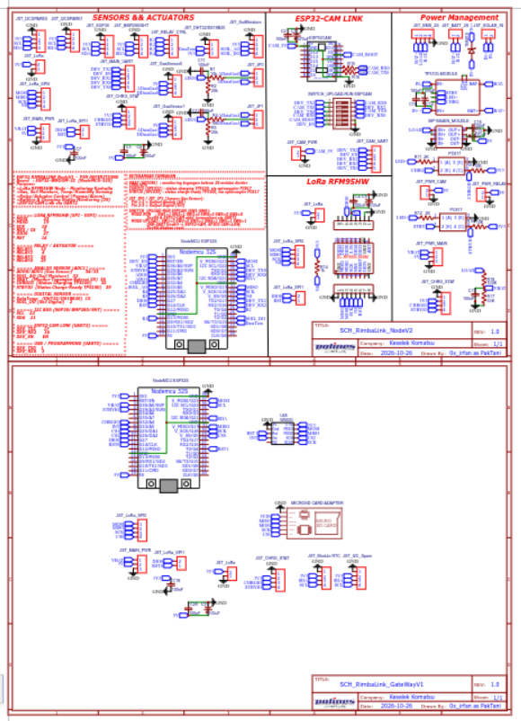
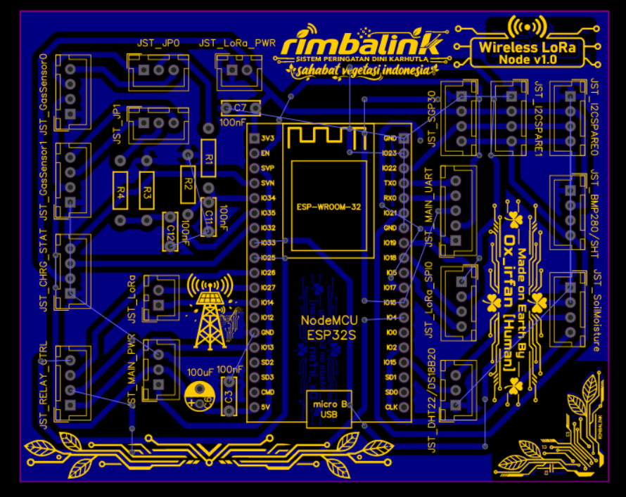
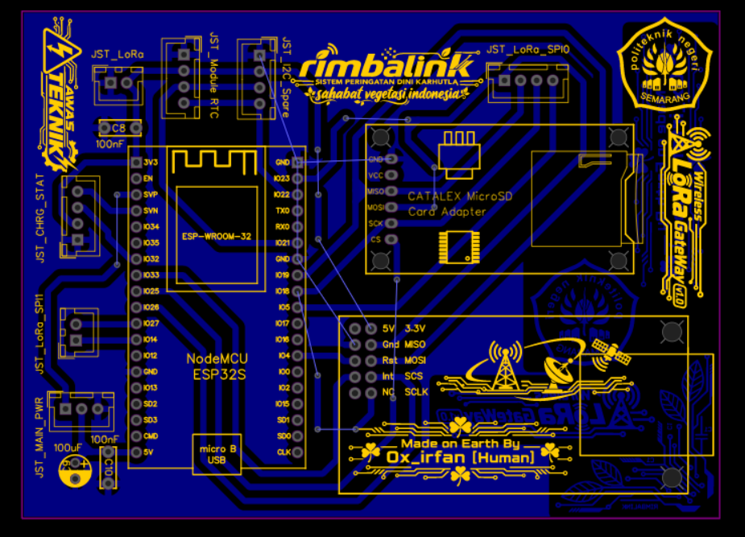
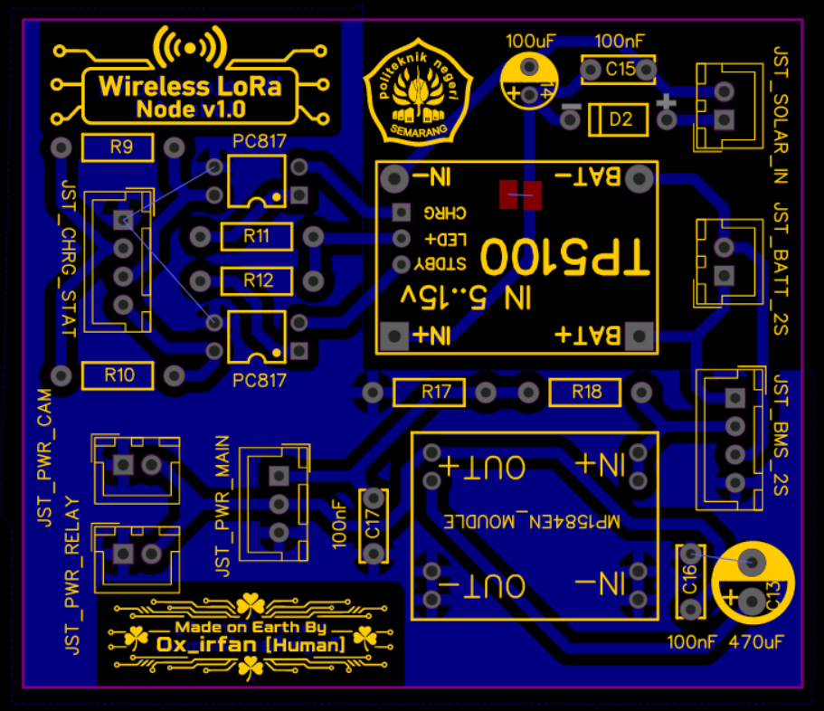
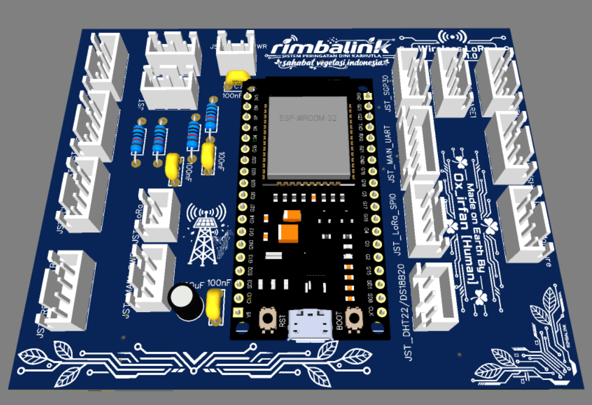
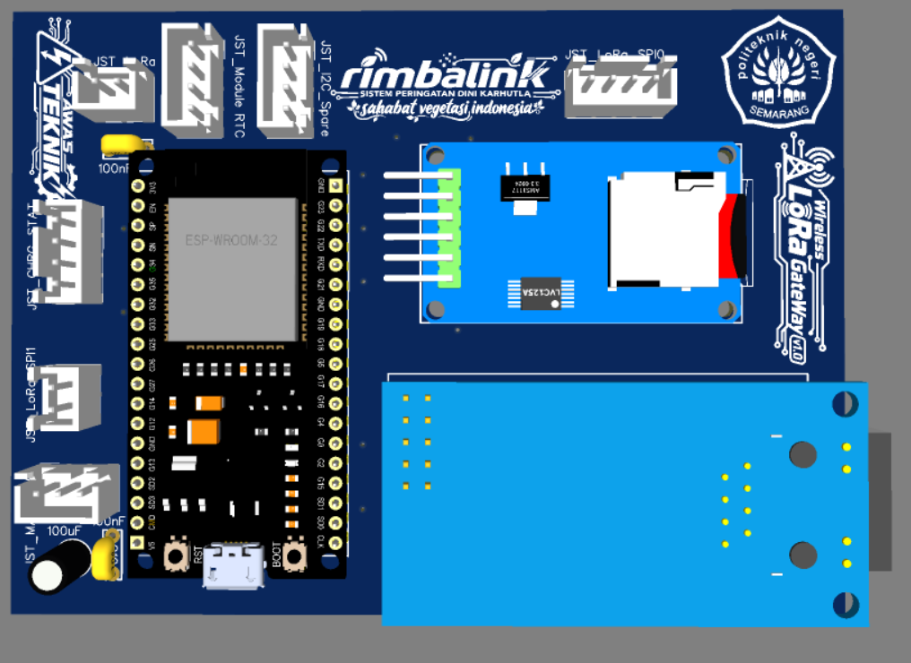
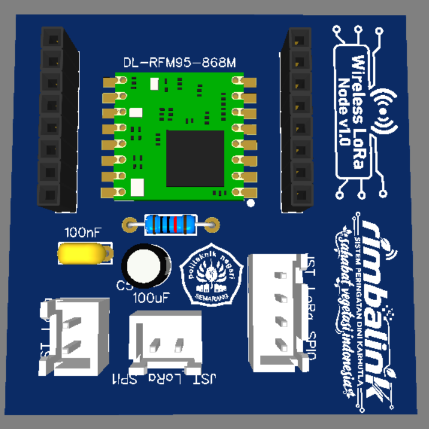
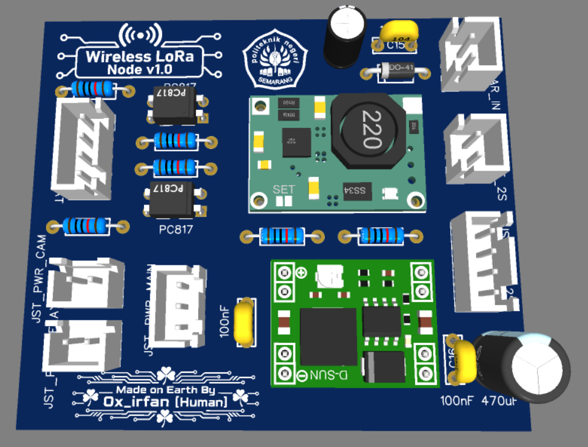
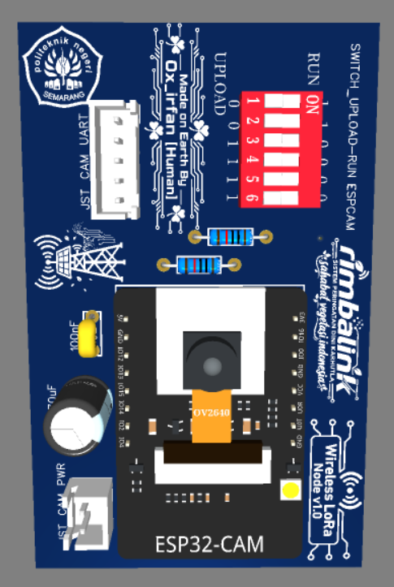

  

  
  
  
  
  

  
  
  

---
Akan opensource pada waktunya🗿Klo lolos pendanaan

### 1. Desain Skematik

| Desain Schematic GateWay Dan Node |
|---|
| 

 |

### 2. Desain PCB

<table align="center">
  <tr>
    <td align="center"><strong>Node</strong> </td>
    <td align="center"><strong>Gateway</strong> </td>
  </tr>
  <tr>
    <td align="center"><strong>LoRa</strong> </td>
    <td align="center"><strong>Power</strong> </td>
  </tr>
  <tr>
    <td align="center" colspan="2"><strong>ESP32-CAM</strong> </td>
  </tr>
</table>

### 3. Visualisasi 3D PCB

<table align="center">
  <tr>
    <td align="center"><strong>Node</strong> </td>
    <td align="center"><strong>Gateway</strong> </td>
  </tr>
  <tr>
    <td align="center"><strong>LoRa</strong> </td>
    <td align="center"><strong>Power</strong> </td>
  </tr>
  <tr>
    <td align="center" colspan="2"><strong>ESP32-CAM</strong> </td>
  </tr>
</table>

### 4. Realisasi PCB

Foto PCB ditampilkan dalam tabel biasa agar tampak depan dan belakang setiap board terlihat langsung tanpa membuka bagian *summary*.

<table align="center">
  <tr>
    <th align="center">Board</th>
    <th align="center">Tampak Depan</th>
    <th align="center">Tampak Belakang</th>
  </tr>
  <tr>
    <td align="center"><strong>Node</strong></td>
    <td align="center"></td>
    <td align="center"></td>
  </tr>
  <tr>
    <td align="center"><strong>Gateway</strong></td>
    <td align="center"></td>
    <td align="center"></td>
  </tr>
  <tr>
    <td align="center"><strong>LoRa</strong></td>
    <td align="center"></td>
    <td align="center"></td>
  </tr>
  <tr>
    <td align="center"><strong>ESP32-CAM</strong></td>
    <td align="center"></td>
    <td align="center"></td>
  </tr>
  <tr>
    <td align="center"><strong>Power</strong></td>
    <td align="center"></td>
    <td align="center"></td>
  </tr>
</table>
