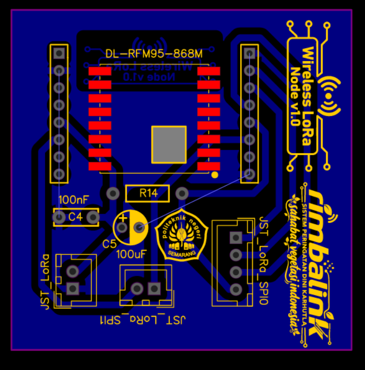
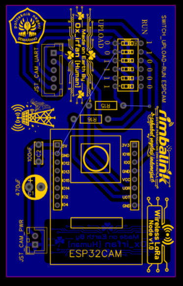
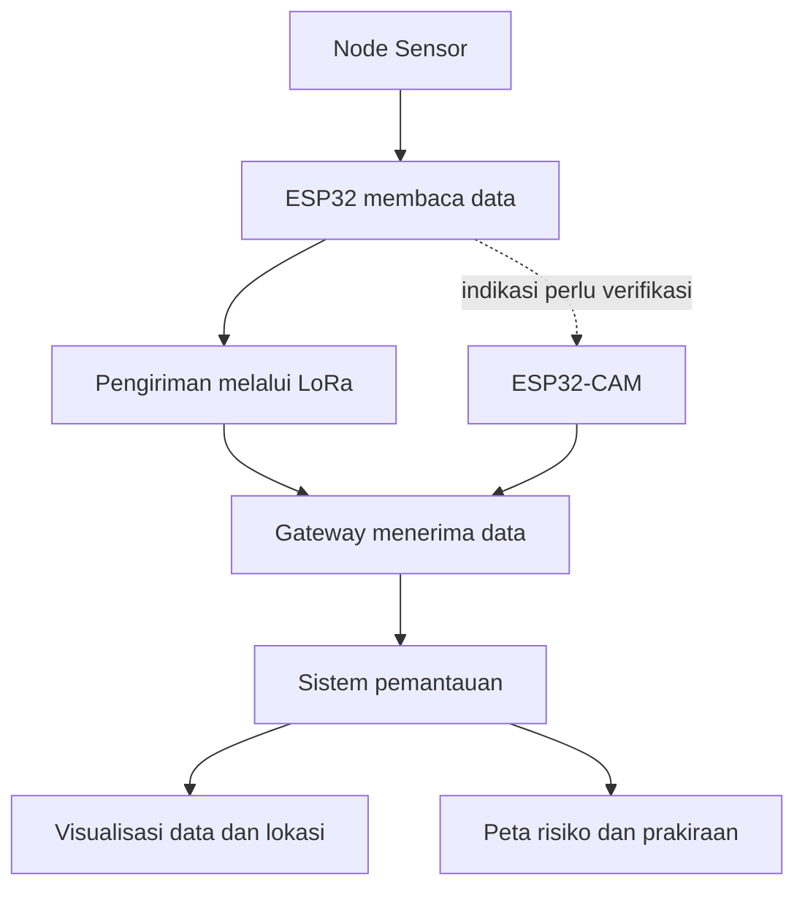

<p align="center">
  
</p>

<p align="center">
  
  
  
  <a href="https://easyeda.com/"></a>
  
</p>

<p align="center">
  
  
  
</p>

---
Akan opensource pada waktunya🗿Klo lolos pendanaan

### 1. Desain Skematik

| Desain Schematic GateWay Dan Node |
|---|
| <p align="center"></p> |

### 2. Desain PCB

Layout PCB disusun berdampingan agar perbandingan setiap desain lebih mudah dilihat.

<table>
  <tr>
    <td align="center"><strong>Node</strong><br></td>
    <td align="center"><strong>Gateway</strong><br></td>
  </tr>
  <tr>
    <td align="center"><strong>LoRa</strong><br></td>
    <td align="center"><strong>Power</strong><br></td>
  </tr>
  <tr>
    <td align="center" colspan="2"><strong>ESP32-CAM</strong><br></td>
  </tr>
</table>

### 3. Visualisasi 3D PCB

Render 3D disusun berdampingan untuk memudahkan perbandingan bentuk dan penempatan komponen.

<table>
  <tr>
    <td align="center"><strong>Node</strong><br></td>
    <td align="center"><strong>Gateway</strong><br></td>
  </tr>
  <tr>
    <td align="center"><strong>LoRa</strong><br></td>
    <td align="center"><strong>Power</strong><br></td>
  </tr>
  <tr>
    <td align="center" colspan="2"><strong>ESP32-CAM</strong><br></td>
  </tr>
</table>

### 4. Realisasi PCB

Dokumentasi berikut disiapkan untuk menampilkan hasil PCB yang telah dibuat. Foto sisi depan dan belakang dapat ditambahkan setelah proses perakitan atau fabrikasi.

<details>
<summary><strong>Node</strong></summary>

<p align="center">
  
  
</p>

<p align="center"><sub>Tampak depan · Tampak belakang</sub></p>

</details>

<details>
<summary><strong>Gateway</strong></summary>

<p align="center">
  
  
</p>

<p align="center"><sub>Tampak depan · Tampak belakang</sub></p>

</details>

<details>
<summary><strong>LoRa</strong></summary>

<p align="center">
  
  
</p>

<p align="center"><sub>Tampak depan · Tampak belakang</sub></p>

</details>

<details>
<summary><strong>ESP32-CAM</strong></summary>

<p align="center">
  
  
</p>

<p align="center"><sub>Tampak depan · Tampak belakang</sub></p>

</details>

<details>
<summary><strong>Power</strong></summary>

<p align="center">
  
  
</p>

<p align="center"><sub>Tampak depan · Tampak belakang</sub></p>

</details>

## Fitur dan Komponen Utama

| Bagian | Peran dalam sistem |
|---|---|
| ESP32 | Pengendali node dan pemrosesan data sensor |
| Sensor lingkungan | Mengukur parameter kondisi lingkungan sesuai sensor yang dipasang |
| LoRa | Komunikasi data jarak jauh antara node dan gateway |
| ESP32-CAM | Mendukung dokumentasi dan verifikasi visual |
| Sistem tenaga surya | Mendukung suplai energi untuk perangkat lapangan |
| Gateway | Menerima data node dan meneruskannya ke sistem pemantauan |
| Peta risiko dan prakiraan | Konteks visualisasi dan analisis informasi pemantauan |

## Alur Kerja



*Diagram ini merupakan gambaran konseptual alur sistem; alur final mengikuti implementasi firmware dan integrasi perangkat.*

## Teknologi dan Perangkat

- **Mikrokontroler:** ESP32
- **Komunikasi nirkabel:** LoRa
- **Kamera:** ESP32-CAM
- **Catu daya:** Sistem tenaga surya
- **Perancangan elektronik:** Schematic dan PCB design
- **Firmware:** Embedded C/C++ (sesuaikan dengan implementasi pada repository)

## Struktur Dokumentasi yang Disarankan

Simpan dokumentasi visual proyek pada folder berikut agar tautan gambar di README dapat ditampilkan oleh GitHub.

```text
RimbaLink/
├── README.md
└── docs/
    └── images/
        ├── rimbalink-banner.png
        ├── system-architecture.png
        ├── schematic-node.png
        ├── schematic-gateway.png
        ├── schematic-overall.png
        ├── pcb-node.png
        ├── pcb-gateway.png
        ├── pcb-lora.png
        ├── pcb-espcam.png
        ├── pcb-power.png
        ├── 3d-node.png
        ├── 3d-gateway.png
        ├── 3d-lora.png
        ├── 3d-espcam.png
        ├── 3d-power.png
        └── real-*.png
```

Nama file gambar pada README harus sama persis dengan nama file yang diunggah ke repository.

## Status Pengembangan

| Tahapan | Status |
|---|---|
| Perancangan arsitektur sistem | Dalam pengembangan |
| Perancangan skematik dan PCB | Dalam pengembangan |
| Integrasi node dan komunikasi LoRa | Perlu diperbarui sesuai hasil implementasi |
| Integrasi gateway dan kamera | Perlu diperbarui sesuai hasil implementasi |
| Integrasi dashboard, peta risiko, dan prakiraan | Perlu diperbarui sesuai hasil implementasi |
| Pengujian lapangan | Perlu diperbarui sesuai hasil pengujian |

## Kontribusi

Saran, diskusi teknis, dan kontribusi untuk pengembangan RimbaLink sangat terbuka. Silakan buat *issue* untuk melaporkan masalah atau mengusulkan fitur, maupun *pull request* untuk mengajukan perubahan.

## Lisensi

Lisensi proyek belum dicantumkan. Tambahkan file `LICENSE` dan perbarui bagian ini setelah lisensi proyek ditentukan.

---

<p align="center">
  <strong>RIMBALINK</strong><br>
  <em>Technology for smarter environmental monitoring.</em>
</p>
