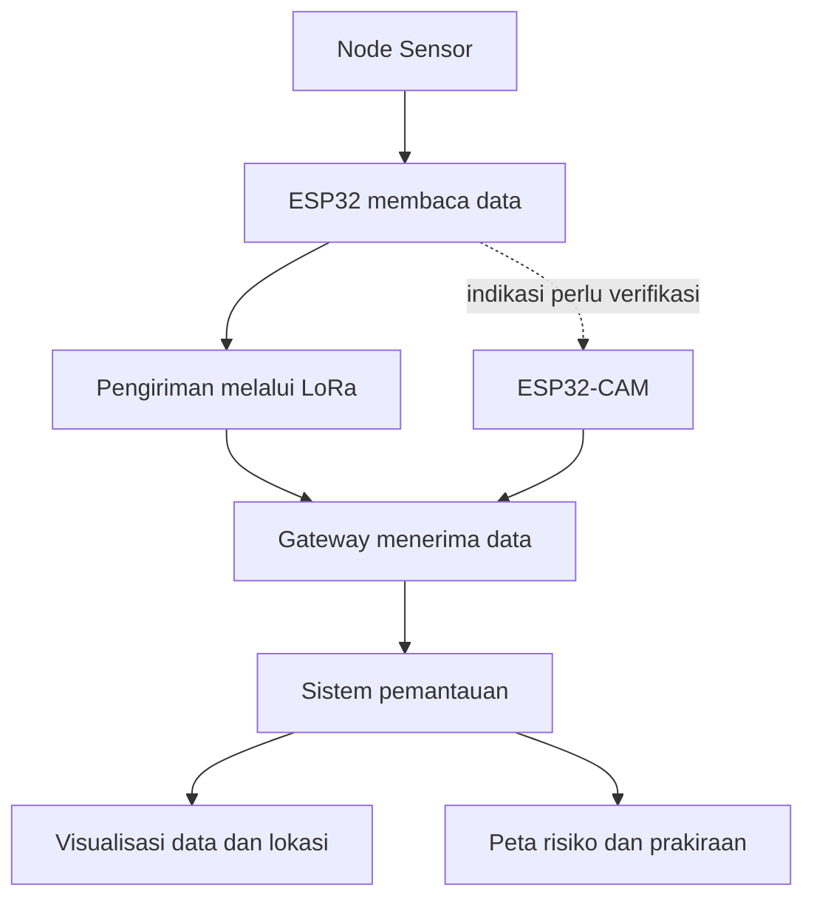

<p align="center">
  
</p>

<p align="center">
  
  
  
  <a href="https://easyeda.com/"></a>
  
</p>

<p align="center">
  <a href="https://github.com/0x-irfan/RimbaLink/stargazers"></a>
  <a href="https://github.com/0x-irfan/RimbaLink/network/members"></a>
  <a href="https://github.com/0x-irfan/RimbaLink/issues"></a>
</p>

<p align="center">
  
  
  
</p>

<p align="center">
  <sub>🌱 Monitoring nature · 📡 Connecting the field · ☀️ Powered by sunlight</sub>
</p>

<p align="center">
  <a href="https://github.com/0x-irfan/RimbaLink">Repository</a> ·
  <a href="#arsitektur-sistem">Arsitektur</a> ·
  <a href="#pengembangan-hardware">Hardware</a> ·
  <a href="#status-pengembangan">Status</a>
</p>

---

## Tentang Proyek

**RimbaLink** adalah rancangan sistem Internet of Things (IoT) untuk mendukung pemantauan kondisi lahan dan peringatan dini kebakaran hutan dan lahan (karhutla). Sistem dirancang menggunakan node sensor berbasis ESP32, komunikasi jarak jauh LoRa, serta sumber daya tenaga surya agar node pemantauan dapat ditempatkan di area yang jauh dari infrastruktur listrik.

Informasi dari node dikirim menuju gateway untuk diteruskan ke sistem pemantauan. Kamera digunakan sebagai sarana verifikasi visual terhadap kondisi atau indikasi kejadian di lapangan. Data pemantauan juga direncanakan dapat ditampilkan bersama peta risiko dan informasi prakiraan.

> **Catatan:** README ini menjelaskan rancangan dan arah pengembangan RimbaLink. Detail sensor, ambang batas peringatan, protokol payload, platform dashboard, serta hasil pengujian akan dilengkapi sesuai implementasi aktual.

## Tujuan

- Mengembangkan sistem pemantauan lahan berbasis IoT dengan komunikasi LoRa.
- Merancang node sensor yang dapat beroperasi menggunakan energi surya.
- Mengirimkan data pemantauan dari node ke gateway secara nirkabel.
- Mendukung verifikasi visual melalui modul kamera.
- Menyajikan informasi pemantauan dalam konteks lokasi dan peta risiko.
- Menjadi platform pengembangan sistem peringatan dini karhutla yang modular.

## Arsitektur Sistem

<p align="center">
  
</p>

**Gambaran alur sistem:**

1. **Node pemantauan** membaca kondisi lingkungan melalui sensor yang terpasang.
2. **Mikrokontroler ESP32** mengolah data awal dan menyiapkan data untuk dikirim.
3. **Modul LoRa** mengirimkan data dari node menuju gateway.
4. **Gateway** menerima data dari node dan menjadi penghubung menuju sistem pemantauan.
5. **Modul kamera ESP32-CAM** mendukung pengambilan gambar untuk verifikasi visual sesuai skenario implementasi.
6. **Sistem pemantauan** mengolah dan menyajikan informasi, termasuk visualisasi lokasi, peta risiko, dan prakiraan apabila modul tersebut telah diintegrasikan.

## Pengembangan Hardware

RimbaLink dikembangkan dengan pendekatan modular. Pemisahan fungsi ke beberapa bagian PCB ditujukan agar perancangan, pengujian, dan perawatan perangkat lebih mudah dilakukan.

### 1. Desain Skematik

Bagian ini memuat dokumentasi hubungan rangkaian elektronik setiap modul.

| Modul | Dokumentasi |
|---|---|
| Node |  |
| Gateway |  |
| Rangkaian keseluruhan |  |

### 2. Desain PCB

Layout PCB dirancang untuk mengintegrasikan komponen pada setiap bagian sistem.

| Modul | Layout PCB |
|---|---|
| Node |  |
| Gateway |  |
| LoRa |  |
| ESP32-CAM |  |
| Power |  |

### 3. Visualisasi 3D PCB

Render 3D digunakan untuk memeriksa penempatan komponen dan gambaran fisik PCB sebelum proses fabrikasi.

| Modul | Render 3D |
|---|---|
| Node |  |
| Gateway |  |
| LoRa |  |
| ESP32-CAM |  |
| Power |  |

### 4. Realisasi PCB

Dokumentasi berikut disiapkan untuk menampilkan hasil PCB yang telah dibuat. Foto sisi depan dan belakang dapat ditambahkan setelah proses perakitan atau fabrikasi.

<details>
<summary><strong>Node</strong></summary>

| Tampak depan | Tampak belakang |
|---|---|
|  |  |

</details>

<details>
<summary><strong>Gateway</strong></summary>

| Tampak depan | Tampak belakang |
|---|---|
|  |  |

</details>

<details>
<summary><strong>LoRa</strong></summary>

| Tampak depan | Tampak belakang |
|---|---|
|  |  |

</details>

<details>
<summary><strong>ESP32-CAM</strong></summary>

| Tampak depan | Tampak belakang |
|---|---|
|  |  |

</details>

<details>
<summary><strong>Power</strong></summary>

| Tampak depan | Tampak belakang |
|---|---|
|  |  |

</details>

## Fitur dan Komponen Utama

| Bagian | Peran dalam sistem |
|---|---|
| ESP32 | Pengendali node dan pemrosesan data sensor |
| Sensor lingkungan | Mengukur parameter kondisi lingkungan sesuai sensor yang dipasang |
| LoRa | Komunikasi data jarak jauh antara node dan gateway |
| ESP32-CAM | Mendukung dokumentasi dan verifikasi visual |
| Sistem tenaga surya | Mendukung suplai energi untuk perangkat lapangan |
| Gateway | Menerima data node dan meneruskannya ke sistem pemantauan |
| Peta risiko dan prakiraan | Konteks visualisasi dan analisis informasi pemantauan |

## Alur Kerja



*Diagram ini merupakan gambaran konseptual alur sistem; alur final mengikuti implementasi firmware dan integrasi perangkat.*

## Teknologi dan Perangkat

- **Mikrokontroler:** ESP32
- **Komunikasi nirkabel:** LoRa
- **Kamera:** ESP32-CAM
- **Catu daya:** Sistem tenaga surya
- **Perancangan elektronik:** Schematic dan PCB design
- **Firmware:** Embedded C/C++ (sesuaikan dengan implementasi pada repository)

## Struktur Dokumentasi yang Disarankan

Simpan dokumentasi visual proyek pada folder berikut agar tautan gambar di README dapat ditampilkan oleh GitHub.

```text
RimbaLink/
├── README.md
└── docs/
    └── images/
        ├── rimbalink-banner.png
        ├── system-architecture.png
        ├── schematic-node.png
        ├── schematic-gateway.png
        ├── schematic-overall.png
        ├── pcb-node.png
        ├── pcb-gateway.png
        ├── pcb-lora.png
        ├── pcb-espcam.png
        ├── pcb-power.png
        ├── 3d-node.png
        ├── 3d-gateway.png
        ├── 3d-lora.png
        ├── 3d-espcam.png
        ├── 3d-power.png
        └── real-*.png
```

Nama file gambar pada README harus sama persis dengan nama file yang diunggah ke repository.

## Status Pengembangan

| Tahapan | Status |
|---|---|
| Perancangan arsitektur sistem | Dalam pengembangan |
| Perancangan skematik dan PCB | Dalam pengembangan |
| Integrasi node dan komunikasi LoRa | Perlu diperbarui sesuai hasil implementasi |
| Integrasi gateway dan kamera | Perlu diperbarui sesuai hasil implementasi |
| Integrasi dashboard, peta risiko, dan prakiraan | Perlu diperbarui sesuai hasil implementasi |
| Pengujian lapangan | Perlu diperbarui sesuai hasil pengujian |

## Kontribusi

Saran, diskusi teknis, dan kontribusi untuk pengembangan RimbaLink sangat terbuka. Silakan buat *issue* untuk melaporkan masalah atau mengusulkan fitur, maupun *pull request* untuk mengajukan perubahan.

## Lisensi

Lisensi proyek belum dicantumkan. Tambahkan file `LICENSE` dan perbarui bagian ini setelah lisensi proyek ditentukan.

---

<p align="center">
  <strong>RIMBALINK</strong><br>
  <em>Technology for smarter environmental monitoring.</em>
</p>
